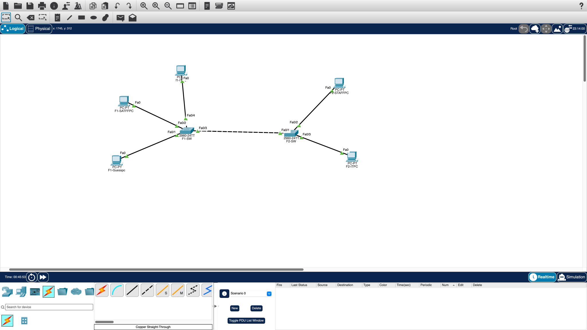

# Day 1 — VLANs and Trunking in a Two-Floor Office

I built a two-floor office network in Cisco Packet Tracer using two Cisco 2960 switches and five PCs. Staff and IT each needed to reach teammates on the other floor. Guest needed to stay separate from Staff.

## How I connected it

| VLAN | Group | Floor 1 access port | Floor 2 access port |
|---|---|---|---|
| 10 | Staff | Fa0/2 | Fa0/2 |
| 20 | Guest | Fa0/1 | No Guest PC |
| 30 | IT | Fa0/4 | Fa0/3 |

One cable connects F1-SW Fa0/3 to F2-SW Fa0/1. I configured both ends as an 802.1Q trunk so Staff and IT could share that cable while keeping their traffic separate.

## Why my Staff ping failed

Both Staff PCs were in the same IP subnet, and both access ports were in VLAN 10. I expected the ping to work, but it timed out. I had configured the ports where the PCs plugged in, but the link between the switches was still carrying only VLAN 1.

I configured the trunk and used `show interfaces trunk` to check that VLAN 10 was forwarding. Then I repeated the same ping and got all four replies.

## How I tested it

| Test | What I observed |
|---|---|
| Floor 1 Staff to Floor 2 Staff | 4 of 4 replies |
| Floor 1 IT to Floor 2 IT | 4 of 4 replies over the same trunk |
| Guest temporarily assigned to VLAN 10 | Guest could ping both Staff PCs |
| Guest moved to VLAN 20 | Pings to both Staff PCs timed out |

The Guest test helped me understand access ports. I kept the same PC, cable, and IP address. Changing which VLAN its switch port belonged to changed who it could reach. I used `show vlan brief` to verify the final port assignments.
